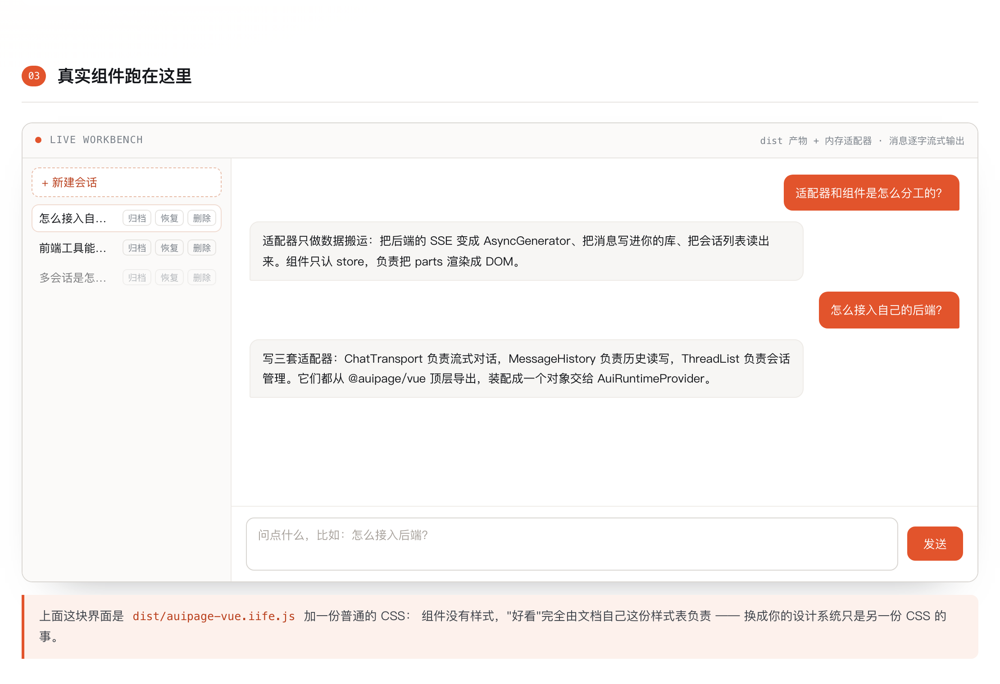

# @auipage/vue

> 智能体页面的 Vue 3 **无头（Headless）组件库**：消息流、会话列表、输入框的状态与交互归库，样式全部归你。

[](https://www.npmjs.com/package/@auipage/vue)
[](https://github.com/handless-ui/auipage-vue/blob/main/LICENSE)
[](https://www.npmjs.com/package/@auipage/vue)



上图是文档站的在线 workbench：会话列表、消息流、输入区全部由本库组件 + 一份普通 CSS 渲染，
消息是真实逐字流式输出（`dist/auipage-vue.iife.js` + 内存适配器）。

## 它是什么

做智能体页面，难的不是气泡样式，而是这些：流式片段怎么拼、会话怎么切、工具调用怎么从「运行中」走到「结果」、
换一个模型后端要不要改界面。`@auipage/vue` 把这些做成状态机，把样式全部留空。

| 取向 | 说明 |
| --- | --- |
| **Headless** | 组件渲染固定标签，挂稳定的 `aui-*` class 与 `data-*` 属性，**不带任何 CSS**。 |
| **Slot** | 遍历交给作用域插槽：`Messages` 给 `{ message }`、`Parts` 给 `{ part }`，模板自己判类型渲染。 |
| **Adapter** | 三套适配器把 HTTP、SSE、WebSocket 挡在库外，换后端不动组件树。 |
| **Vue 3** | 纯 `defineComponent` + `h` 实现，不依赖模板编译器；支持 `<script setup>` 与 TS。 |

## 提供什么

| 导出 | 渲染标签 | 说明 |
| --- | --- | --- |
| `AuiRuntimeProvider` | — | 装配 `AuiPage` 与状态，向下提供 context（`:adapter` / `:tools`） |
| `ChatContent.Root` / `Viewport` | `div` | 根容器 / 滚动视口 |
| `ChatContent.Messages` / `Parts` | `div` / `span` | 遍历消息 `{ message }` / 遍历片段 `{ part }` |
| `ChatContent.Composer.Root` / `Input` / `Send` | `form` / `textarea` / `button` | 输入区三件 |
| `ThreadList.Root` / `New` / `Items` / `Item.*` | `div` / `button` / `span` | 会话新建、切换、归档、删除 |
| `ChatTransportAdapter` 等 | 类 | 三套适配器，从 `@auipage/core` 透出 |
| `defineTool` | 函数 | 定义前端工具，`render` 是一个 Vue 组件 |
| `generator` | 工具函数 | 把回调式流读取包成 `AsyncGenerator` |

## 安装

```bash
npm install @auipage/vue
```

依赖 `vue ^3.4.34`、`@auipage/core ^0.1.0`，无需引入任何 CSS。

## 最小接入

```vue
<template>
    <AuiRuntimeProvider :adapter="adapter" :tools="tools">
        <ThreadList.Root>
            <ThreadList.New>新建会话</ThreadList.New>
            <ThreadList.Items v-slot="{ thread }">
                <ThreadList.Item.Root>
                    <ThreadList.Item.Trigger>
                        <ThreadList.Item.Title />
                    </ThreadList.Item.Trigger>
                </ThreadList.Item.Root>
            </ThreadList.Items>
        </ThreadList.Root>

        <ChatContent.Root>
            <ChatContent.Viewport>
                <ChatContent.Messages v-slot>
                    <ChatContent.Parts v-slot="{ part }">
                        <p v-if="part.type === 'text'">{{ part.text }}</p>
                        <p v-else-if="part.type === 'thinking'" class="think">{{ part.text }}</p>
                    </ChatContent.Parts>
                </ChatContent.Messages>
            </ChatContent.Viewport>
            <ChatContent.Composer.Root>
                <ChatContent.Composer.Input />
                <ChatContent.Composer.Send>发送</ChatContent.Composer.Send>
            </ChatContent.Composer.Root>
        </ChatContent.Root>
    </AuiRuntimeProvider>
</template>
```

```ts
// adapter.ts —— 三个实例，key 名固定
import { ChatTransportAdapter, MessageHistoryAdapter, ThreadListAdapter } from "@auipage/vue";

export default {
    ChatTransport: new ChatTransportAdapter({
        async *run({ messages, context }) {
            yield { type: "text", text: "你好。" };
        },
        response(name, data) { /* 工具结果回传 */ },
    }),
    MessageHistory: new MessageHistoryAdapter({
        async load(threadId) { /* 历史消息组 */ },
        async append(threadId, group) { /* 落库 */ },
    }),
    ThreadList: new ThreadListAdapter({
        async list() { /* 会话列表 */ },
        async new(firstGroup) { /* 建会话 */ },
        async archive(id) { }, async unarchive(id) { }, async delete(id) { },
    }),
};
```

## 不打包，直接引用

```html
<script src="https://unpkg.com/vue@3.4.34/dist/vue.global.prod.js"></script>
<script src="https://unpkg.com/@auipage/vue@latest/dist/auipage-vue.iife.js"></script>
<script>
    const { AuiRuntimeProvider, ChatContent, ThreadList } = AuipageVue;
</script>
```

IIFE 构建通过全局 `Vue` 使用 Vue，因此要先加载 Vue，再加载本库。打包器环境会处理依赖，不需要手动加载全局脚本。

## 版权

MIT License

Copyright (c) [zxl20070701](https://zxl20070701.github.io/notebook/home.html) 走一步，再走一步
